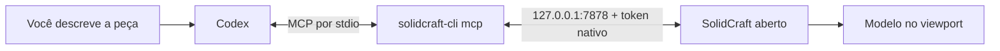

<div align="center">

# 🧊 SolidCraft × Codex

**Modele CAD conversando com o Codex — e acompanhe as mudanças no SolidCraft.**


[Começar](#-instalação) · [Exemplos](#-o-que-pedir-ao-codex) · [Problemas comuns](#-problemas-comuns)

</div>

---

## ✨ O que é

Um pacote para conectar o **Codex ao projeto aberto no SolidCraft**, usando o servidor MCP que já acompanha o aplicativo. Você descreve a peça ou a alteração, e o Codex pode inspecionar o modelo, executar comandos CAD, medir o resultado e salvar uma nova versão.

> **Sobre o nome “plugin”:** este projeto configura uma ponte externa. O sistema de plugins documentado pelo SolidCraft ainda lista manifestos sem executar código. O controle acontece pelo **MCP nativo**, não pelo carregamento de um plugin executável. A pasta Plugins recebe o pacote para mantê-lo acessível.

## 🛠️ O que você pode fazer

| Recurso | Exemplos |
| --- | --- |
| Criar peças | Caixas, suportes, placas, furos e encaixes |
| Editar modelos | Alterar parâmetros e operações de projetos editáveis |
| Inspecionar | Consultar medidas, corpos, histórico e erros |
| Verificar | Comparar dimensões e visualizar o resultado |
| Exportar | Gerar arquivos nos formatos suportados pelo SolidCraft |

O alcance depende dos comandos da sua versão do SolidCraft. Malhas importadas de STL não têm o mesmo histórico paramétrico de um modelo construído no CAD; algumas alterações exigem conversão ou reconstrução. Não é uma promessa de controle de 100% da interface.

## 📦 Requisitos

- Windows 10 ou 11.
- [SolidCraft](https://github.com/tangency-labs/solidcraft) com `solidcraft.exe` e `solidcraft-cli.exe`.
- [Node.js 18 ou superior](https://nodejs.org/) disponível no PATH.
- Codex com suporte a servidores MCP locais.

**Não precisa de PowerShell, Python, `npm install` ou chave de API adicional para esta ponte.** O acesso ao Codex continua dependendo da sua própria conta/configuração.

## 🚀 Instalação

### 1. Baixe o pacote

Use **Code → Download ZIP** neste repositório e extraia o conteúdo em uma pasta. Ou clone:

```bat
git clone https://github.com/Luispessoa18/solidcraft_codex_plugin.git
cd solidcraft_codex_plugin
```

### 2. Instale a integração

Dê dois cliques em **`instalar.cmd`**. O instalador:

- Localiza o SolidCraft em `Program Files\SolidCraft` ou `%LOCALAPPDATA%\Programs\SolidCraft`.
- Copia o pacote para `%LOCALAPPDATA%\SolidCraft\plugins\codex-control`.
- Adiciona ou atualiza somente a seção `[mcp_servers.solidcraft-live]` no `config.toml` do Codex.
- Cria um backup antes de alterar uma configuração existente.

O caminho padrão da configuração é `%USERPROFILE%\.codex\config.toml`. Se `CODEX_HOME` estiver definido, ele será usado. Uma seção `solidcraft-live` existente será substituída pela configuração deste pacote.

### 3. Abra o SolidCraft com controle ativo

**Salve seu trabalho e feche as janelas anteriores do SolidCraft.** Dê dois cliques em **`iniciar.cmd`** e abra seu projeto nessa nova janela.

O launcher inicia o aplicativo com `--control 7878`. Ele não encerra instâncias nem salva projetos automaticamente.

### 4. Reabra o Codex

Feche e reabra o Codex para carregar `solidcraft-live`. Comece pedindo:

```text
Use o solidcraft-live para inspecionar o projeto aberto.
Me diga o nome do projeto, os corpos e as dimensões antes de alterar qualquer coisa.
```

### 5. Confira a conexão

Execute **`diagnostico.cmd`**. Ele lista as ferramentas MCP e chama `inspect_design`, sem editar a peça. Ver o nome do seu projeto na resposta confirma o acesso ao documento.

## 💬 O que pedir ao Codex

```text
Crie um suporte em L com base de 60 × 40 mm, espessura de 4 mm
e dois furos de 5 mm. Confira as medidas e salve uma cópia.
```

```text
Inspecione esta caixa. Aumente a largura para 100 mm mantendo
a espessura das paredes e a posição dos furos em relação às bordas.
```

```text
Confira se a peça é fechada, informe as dimensões gerais
e exporte um STL para impressão 3D sem sobrescrever o original.
```

Quanto mais claras forem as dimensões, folgas e restrições, mais fácil será conferir o resultado. Faça um teste físico de encaixe quando a peça precisar acoplar a outra.

## 🔌 Como funciona



O pacote não abre um servidor próprio nem substitui a autenticação do SolidCraft. Usa o token local gerado pelo aplicativo e preserva as restrições de acesso a arquivos do MCP. Não ativa `--allow-any-path`.

Configuração gerada em uma instalação padrão:

```toml
[mcp_servers.solidcraft-live]
command = 'C:\Program Files\SolidCraft\solidcraft-cli.exe'
args = ["mcp", "--connect", "127.0.0.1:7878"]
```

## 🔧 Problemas comuns

| Sintoma | Como resolver |
| --- | --- |
| `node` não encontrado | Instale o Node.js e abra uma nova janela do terminal. |
| SolidCraft não encontrado | Defina `SOLIDCRAFT_CLI` com o caminho completo do CLI e execute o instalador novamente. |
| `no SolidCraft app is listening` | Abra o aplicativo pelo `iniciar.cmd`. |
| Projeto `Untitled` ou vazio | Abra seu arquivo na janela iniciada pelo launcher. Pode haver outra instância aberta. |
| `unauthorized` | Reinicie o SolidCraft pelo launcher e o Codex. Verifique se ambos estão no mesmo usuário do Windows e se o ambiente permite ler o token local. Não compartilhe o token. |
| Ferramentas não aparecem no Codex | Confira a seção `solidcraft-live` no arquivo de configuração e reinicie o Codex. |
| `outside the folders this agent may use` | Use uma pasta autorizada pelo MCP ou configure explicitamente `--allow-path` para a pasta necessária. |
| Porta 7878 ocupada | Feche a instância anterior. Para usar outra porta, ajuste o launcher e a seção MCP em conjunto. |

Para uma instalação fora do padrão, execute no **CMD**, substituindo o caminho:

```bat
set "SOLIDCRAFT_CLI=D:\Aplicativos\SolidCraft\solidcraft-cli.exe"
instalar.cmd
iniciar.cmd
```

Essa variável vale para o terminal atual; repita a definição ao usar o launcher em outro terminal, ou configure-a nas variáveis de ambiente do Windows.

## 🧪 Compatibilidade e testes

A conexão MCP foi verificada com **SolidCraft 0.40.1 no Windows**, incluindo inspeção, medição, captura de imagem, abertura e salvamento de modelos. O conjunto instalado expôs 22 ferramentas. Outras versões podem oferecer funções diferentes.

O instalador de distribuição também foi verificado com uma configuração de teste isolada: preservação de outras seções, backup e reexecução sem duplicar a entrada MCP. Execute `diagnostico.cmd` para verificar a sua instalação.

## 📁 Arquivos

| Arquivo | Função |
| --- | --- |
| `instalar.cmd` / `instalar.cjs` | Instala o pacote e configura o Codex |
| `iniciar.cmd` / `iniciar.cjs` | Abre o SolidCraft com controle ativo |
| `diagnostico.cmd` / `diagnostico.cjs` | Verifica o acesso ao projeto |
| `caminhos.cjs` | Localiza os executáveis do SolidCraft |
| `plugin.json` | Identifica o pacote na lista de plugins |

## 🗑️ Desinstalação

Remova a seção `[mcp_servers.solidcraft-live]` do `config.toml` e a pasta `%LOCALAPPDATA%\SolidCraft\plugins\codex-control`. Se já usava uma configuração com esse nome, recupere a seção anterior pelo backup criado pelo instalador. Depois reinicie o Codex.

## 🤝 Contribua

Encontrou um problema? Abra uma [issue](https://github.com/Luispessoa18/solidcraft_codex_plugin/issues) com a versão do Windows, Node.js e SolidCraft, o erro e os passos para reproduzir. Remova caminhos privados e tokens antes de compartilhar logs.

Melhorias de instalação, documentação e compatibilidade são bem-vindas por pull request.

## 📚 Referências

- [SolidCraft: integração MCP](https://github.com/tangency-labs/solidcraft/blob/main/docs/mcp.md)
- [SolidCraft: estado do sistema de plugins](https://github.com/tangency-labs/solidcraft/blob/main/docs/rfcs/0002-plugins.md)
- [OpenAI: MCP no Codex](https://developers.openai.com/codex/mcp/)

Projeto independente, sem afiliação oficial com SolidCraft ou OpenAI. Código deste pacote sob a [licença MIT](LICENSE); os aplicativos têm suas próprias licenças.
